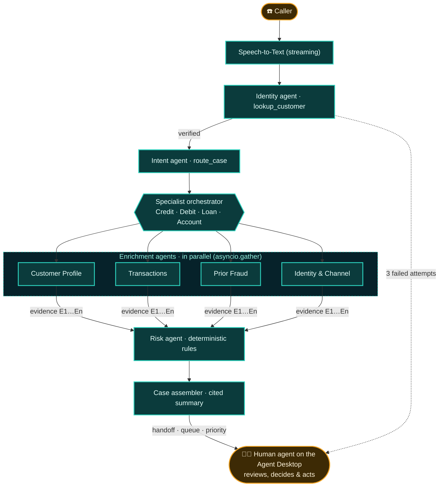
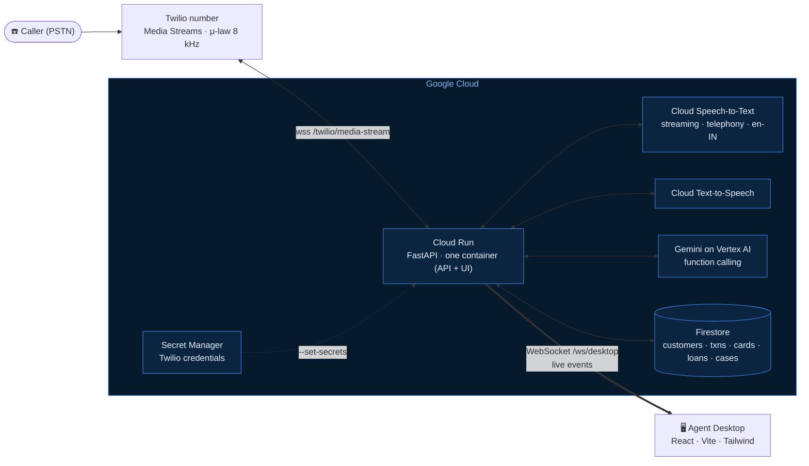
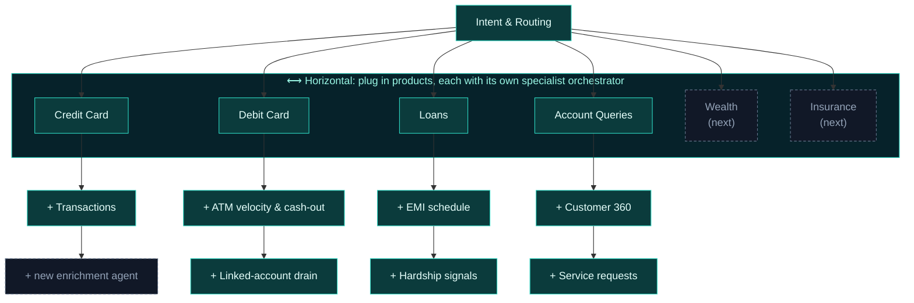

<div align="center">

<a href="https://caseforge-1042844127737.asia-south1.run.app/"></a>

# CaseForge AI

### Agents Assemble the Case. Humans Close It.

**Every call reaches the human agent already investigated.**

[](https://caseforge-1042844127737.asia-south1.run.app/)

[](#-engineering)
[](#-engineering)
[](#-engineering)
[](#-engineering)
[](#-tech-stack)
[](#-tech-stack)
[](docs/SETUP.md#13-testing--verification)
[](#-ai-safety)

</div>

> 🏦 **BFSI context:** a multi-agent contact centre for banks, cards and lending, where every call can be a fraud case.

---

## 📞 Try the live demo

<div align="center">

<a href="https://caseforge-1042844127737.asia-south1.run.app/"></a>

**[caseforge-1042844127737.asia-south1.run.app](https://caseforge-1042844127737.asia-south1.run.app/)** · running on Cloud Run with Gemini on Vertex AI and Firestore

</div>

1. Open the **agent desktop** above. Every call shows up there live.
2. Click **Simulate call ▾** (or one of the scenario cards). A scripted caller talks to *Maya*, the AI assistant, through the **same pipeline** a real call uses.
3. Watch the identity, intent, parallel agents, risk score and cited case build up, and then the handoff to a human.

> [!NOTE]
> ☎️ **Real phone calls are supported too.** CaseForge takes real inbound calls on a **Twilio number**, with live voice: caller → Cloud **Speech-to-Text** (streaming) → **Gemini** agents → Cloud **Text-to-Speech** → caller, including barge-in. A phone call and *Simulate call* drive the same `CallSession` and send the same events to the desktop, so the simulator shows exactly what a phone call does.

**What the caller says** in each scenario. Callers verify with their **name plus the last 4 digits of the registered mobile**, *or* their **name plus the customer ID**.

| Scenario | 1. Who they are | 2. Verification | 3. The problem (in their own words) | You'll see |
|---|---|---|---|---|
| 💳 **Credit card fraud** | "Hi, my name is **Aarav Mehta**." | "The last four digits are **4 8 2 1**." | "I got an SMS for a charge of about **one lakh eighty-four thousand rupees** on my **credit card** at an electronics store in **Romania**. I'm in Mumbai and the card is with me." | Risk **CRITICAL** → Card Fraud Desk, P1 |
| 🏧 **Debit card stolen** | "Hello, this is **Priya Nair**." | "My customer ID is **C1002**." | "I **can't find my debit card**, and I woke up to alerts for **several ATM withdrawals** last night, around fifty thousand rupees. Money was also transferred out of my savings account." | Risk **CRITICAL** → Card Fraud Desk, P1 |
| 🏠 **Home loan hardship** | "Hi, **Rohan Gupta** here." | "The last four of my mobile are **5 5 6 2**." | "I **lost my job in July** and I've **missed my home loan EMIs** for two months. Can I get some relief or restructuring?" | Risk **CRITICAL** → Collections & Hardship, P1 |
| 🧾 **Simple account query** | "Hi, I'm **Sneha Iyer**." | "My mobile ends in **9 0 4 7**." | "What's my **savings account balance**? And has my **cheque book** been dispatched?" | Risk **LOW**. Maya answers herself: **Resolved by AI** |

<sub>You can also type as the caller: click **Start a typed call** on the desktop.</sub>

---

## 🔥 The problem

When a customer calls about a suspicious charge, the human agent **starts from zero**. They jump between the CRM, the card systems and the fraud tools while the customer waits.

<table>
<tr>
<td width="55%">

- 🔎 **Lookups eat the call.** Industry estimates put **40–70% of handle time** on lookups.
- 🧩 **Clues sit on different screens:** a SIM swap in one system, a password reset in another, a foreign charge in a third.
- ⚠️ **So fraud signals get missed**, and the customer repeats their story.

<sub>40–70% is an industry estimate quoted as a claim, not something CaseForge measured.</sub>

</td>
<td width="45%"></td>
</tr>
</table>

## ✅ How CaseForge solves it

While Maya talks to the caller, **AI agents do the legwork**. Then **a human takes over**, with the whole case in front of them.

| | Without CaseForge | With CaseForge |
|---|---|---|
| **Identity** | The agent asks security questions | The identity agent verifies through `lookup_customer`, and Customer 360 is loaded before the handoff |
| **Understanding** | "So, what seems to be the problem?" | The intent agent classifies the issue and extracts the amount, merchant, location and card status |
| **Investigation** | Many screens, one at a time | A specialist orchestrator runs its enrichment agents **in parallel** |
| **Risk** | Gut feel | A **deterministic** 0–100 score with explainable reason codes |
| **Handoff** | A cold transfer | A **cited** case file, suggested questions and recommended actions, sent to the right desk at the right priority |
| **Decision** | Human | **Still human.** Actions only happen when a person clicks |

## 🔄 How it works

<sub>🟦 teal = AI · 🟧 amber = human</sub>



1. **Identity.** Maya asks for a **name**, plus the **last 4 digits of the registered mobile** or a **customer ID**. `lookup_customer` checks it against Firestore, and the match becomes evidence **E1**. After **3 failed attempts**, a human takes over.
2. **Intent.** Gemini is forced to make a `route_case` function call (offline, a rules engine does it). It returns the intent and entities: amount, date, merchant, location, `card_in_possession` and more.
3. **Fan-out.** The route's orchestrator starts every enrichment agent at once. Each tool output is logged as evidence.
4. **Risk, then the case.** Code computes the score and Gemini writes the narrative. Every key finding cites an evidence ID.
5. **Handoff.** The case goes to the right desk (for example **Card Fraud Desk, P1**), and simple queries are answered by AI. The human closes it.

---

## 🛠 Engineering

### Google Cloud architecture



- **Least-privilege service account** `caseforge-sa`, with exactly 5 roles: `aiplatform.user`, `datastore.user`, `secretmanager.secretAccessor`, `logging.logWriter` and `speech.client`.
- **Barge-in:** if the caller talks over Maya, playback stops. `VOICE_MODE=gather` (Twilio `<Gather>` + Cloud TTS `<Play>`) is the fallback.
- **Graceful degradation:** if Gemini is slow or unavailable, each agent falls back to its deterministic path. The UI shows `Gemini` or `rules` for each agent.

### Agents & tools

<sub>Orchestrators: **Credit Card** (4 agents) · **Debit Card** (6) · **Loan** (5) · **Account Queries** (4). 11 sub-agents and 13 tools in total.</sub>

| Agent | Tool(s) | Used by |
|---|---|---|
| Greeting & Identity | `lookup_customer(name, mobile_last4 \| customer_id)` | every call |
| Intent & Routing | `route_case(intent, confidence, entities, …)`, forced function call | every call |
| Customer Profile | `get_customer_profile` | Credit · Debit · Loan |
| Transaction Enricher | `get_recent_transactions(days, instrument)` | Credit · Debit |
| Prior Fraud & Alert | `get_prior_fraud_flags` | Credit · Debit · Account |
| Identity & Channel | `check_ani_match`, `check_recent_auth_events` | all four |
| ATM Velocity | `get_atm_velocity(hours)` | Debit |
| Linked Account | `get_linked_account_activity(hours)` | Debit |
| EMI Schedule · Repayment & Bounce · Hardship Signals | `get_emi_schedule` · `get_repayment_history` · `get_hardship_signals` | Loan |
| Customer 360 · Service Requests | `get_customer_360` · `get_service_requests` | Account |
| Risk Scoring | *deterministic Python, no LLM* | all four |
| Case Assembler | Gemini JSON mode, with citations checked against the evidence | all four |

> 🔒 Once the caller is verified, every tool call has `customer_id` **forced to the verified customer**. The model can't read anyone else's data, even under prompt injection.

### Risk scoring, in brief (`backend/app/agents/risk.py`)

```text
raw   = baseline (bank risk rating: LOW 3 · MEDIUM 10 · HIGH 22) + Σ reason-code points
score = max( round(100 · (1 − e^(−raw/45))), baseline )      → always 0–100
band  = LOW < 30 ≤ MEDIUM < 60 ≤ HIGH < 80 ≤ CRITICAL
```

- **Reason codes, not vibes.** Each detector adds a code, its points, a detail line and the evidence IDs behind it. Examples: `GEO_VELOCITY` +25 (more than 300 km at over 800 km/h), `UNUSUAL_AMOUNT` +20 (more than 5× the 90-day mean and at least ₹25k), `ATM_VELOCITY` +20, `SIM_SWAP_RECENT` +15, `PRIOR_SAR` +15, `NEW_COUNTRY` +10, `CARD_TESTING` +10, `ANI_SIM_SWAPPED` +5…
- **Caps.** The saturating curve means many weak signals can't trivially reach 100, and `EMI_BOUNCES` is capped at 30 points (10 per bounce).
- **Worked example (from the explainer recording):** 11 reason codes (115 points) plus a baseline of 3 gives raw 118, and 100·(1−e^(−118/45)) = **93 → CRITICAL**.

### Real-time WebSocket events

One `CallSession` drives phone calls, the simulator and typed calls alike. It publishes events to an `EventHub`, which streams them to `/ws/desktop`. The React desktop is an **event-sourced reducer**: it rebuilds the whole call from the stream and gets a replay when it reconnects.

```text
call.started → transcript → identity.update → customer.snapshot → intent.classified
→ orchestrator.started → agent.started ×N (all before any completes) → agent.completed ×N
→ risk.scored → case.assembled → handoff → call.ended → case.logged
```

<sub>Also: `call.stage`, `voice.state`, `error`.</sub>

---

## 📈 Scalability: horizontal and vertical



| Direction | What you add | How it plugs in |
|---|---|---|
| ⟷ **Horizontal** | A new product line (wealth, insurance…) | One entry in `ORCHESTRATORS`: a title, a list of agents and a scorer, plus a new `route_case` intent |
| ↕ **Vertical** | A new enrichment agent (for example ATM velocity, hardship signals) | One `SubAgentSpec` and one tool. It joins the parallel `asyncio.gather` fan-out, and **every new agent deepens the case** |

---

## 🛡 AI safety

<sub>The human always decides, and every fact is cited.</sub>

| | Pillar | How the code enforces it |
|---|---|---|
| 📎 | **Full Citations** | Every tool output becomes evidence (`E1`, `E2`…). Each key finding cites one, and the assembler drops any citation that doesn't exist |
| 🔐 | **Least-Privilege** | `caseforge-sa` has 5 IAM roles only. Tools are bound to the verified customer |
| 🗂️ | **Complete Logging** | `session.end()` saves the case, transcript and disposition to Firestore `cases` after every call |
| ✋ | **No Autonomous Actions** | Block card, raise dispute and the other actions are click-only, and the AI is told "Do not take actions". The risk score comes from code, not the LLM |
| 🧑‍⚖️ | **Human-in-the-Loop** | Fraud, debit and loan cases go to a human queue. Only simple, read-only queries (balance, cheque book…) are resolved by AI |

---

## 🎬 Demo scenarios: real scores

<sub>Output of `verify_ws.py` against the app in offline mode (rules engine, in-memory copy of the seed data) on 18 Oct 2026, all `[PASS]`. The live deploy runs the same deterministic risk code on Gemini and Firestore.</sub>

| Scenario | Caller | Route → orchestrator | Parallel agents | Risk | Top reason codes | Outcome |
|---|---|---|---|---|---|---|
| 💳 Credit card fraud | Aarav Mehta · C1001 | `CREDIT_CARD_FRAUD` (0.90) → Credit Card Remediation | 4 | **94 CRITICAL** (raw 128) | GEO_VELOCITY +25, UNUSUAL_AMOUNT +20, SIM_SWAP_RECENT +15 | Card Fraud Desk · **P1** |
| 🏧 Debit card stolen | Priya Nair · C1002 | `DEBIT_CARD_FRAUD` (0.88) → Debit Card Remediation | 6 | **94 CRITICAL** (raw 128) | ATM_VELOCITY +20, CASH_OUT_PATTERN +20, LINKED_ACCOUNT_DRAIN +15 | Card Fraud Desk · **P1** |
| 🏠 Loan hardship | Rohan Gupta · C1003 | `LOAN_HARDSHIP` (0.86) → Loan Agent | 5 | **92 CRITICAL** (raw 115) | EMI_BOUNCES +30, DPD_60_PLUS +25, SALARY_STOPPED +20 | Collections & Hardship · **P1** |
| 🧾 Account query | Sneha Iyer · C1004 | `ACCOUNT_QUERY` (0.85) → Account Queries | 4 | **6 LOW** (raw 3, baseline only) | none | **Resolved by AI** · P4 |

> [!NOTE]
> The seed data's timestamps are relative to "now", so time-window signals can move as the data ages. In the explainer recording, the credit card case scored **93** (raw 118, without the 24 h `VELOCITY_SPIKE` +10).

---

## 🖼 Screenshots & stills

<p align="center"><br/><sub>The real Agent Desktop mid-call: live transcript, agent activity, Customer 360, cited case summary and the Fraud Risk gauge.</sub></p>

| | |
|---|---|
| <br/><sub>Identity agent: `lookup_customer` → E1, then Customer 360</sub> | <br/><sub>Parallel fan-out, and the ANI "match but SIM swapped" check</sub> |
| <br/><sub>Deterministic risk: 11 reason codes → raw 118 → 93</sub> | <br/><sub>Specialist branches: horizontal and vertical</sub> |
| <br/><sub>The five AI safety pillars</sub> | <br/><sub>How CaseForge works (explainer v1)</sub> |
| <br/><sub>Parallel agent orchestration (trailer)</sub> | <br/><sub>The problem (trailer)</sub> |

<details>
<summary><b>Full-page desktop screenshots</b></summary>


</details>

---

## 🧰 Tech stack

| Layer | Tech |
|---|---|
| Voice | Twilio Media Streams · Cloud Speech-to-Text (streaming) · Cloud Text-to-Speech |
| Reasoning | Gemini on Vertex AI via `google-genai` (function calling, JSON mode, a fallback model chain) |
| Backend | Python · FastAPI · asyncio · WebSockets |
| Data | Firestore (10 customers, 343 transactions, cards, accounts, loans, fraud flags, auth events, cases) |
| Platform | Cloud Run · Secret Manager · Cloud Logging · Cloud Build |
| Frontend | React 18 · Vite 5 · Tailwind CSS 3 · Framer Motion |
| Offline mode | `LLM_MODE=mock` + `DATA_BACKEND=memory`, with a built-in call simulator |

<details>
<summary><b>📁 Project structure</b></summary>

```text
caseforge-ai/
├── backend/app/
│   ├── main.py            # FastAPI: REST, /ws/desktop, simulator, static UI
│   ├── core/              # session.py (CallSession), llm.py (Gemini), datastore.py, events.py, simulator.py
│   ├── agents/            # identity · intent · orchestrators · subagents · tools · risk · assembler
│   ├── voice/             # twilio_routes.py (Media Streams / Gather), stt.py, tts.py
│   └── data/seed_data.json
├── backend/tests/         # 4 flows, Twilio Gather + Media Streams, Gemini tool loop
├── backend/scripts/       # generate_seed_data.py, verify_ws.py (live smoke test)
├── frontend/src/          # App.jsx, event-sourced store, desktop components
├── scripts/               # setup_gcp.sh, deploy_cloud_run.sh, setup_twilio.py, seed_firestore.sh, run_local.sh
├── docs/                  # SETUP.md (full guide), assets/ (screenshots & stills)
└── Dockerfile · docker-compose.yml · Makefile · .env.example
```

</details>

---

<sub>🔧 Want to self-host it (offline, GCP, or with your own Twilio number)? See the full guide in **[docs/SETUP.md](docs/SETUP.md)**.</sub>
