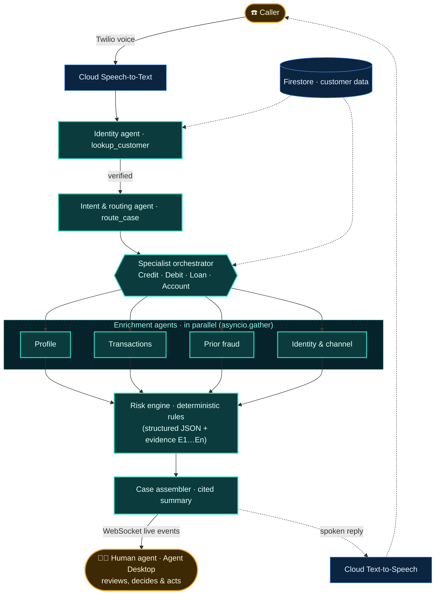

<div align="center">

<a href="https://caseforge-1042844127737.asia-south1.run.app/"></a>

# CaseForge AI
### Agents Assemble the Case. Humans Close It.

[](https://caseforge-1042844127737.asia-south1.run.app/)

[](#-google-cloud-tools)
[](#-google-cloud-tools)
[](#-google-cloud-tools)
[](#-environment--call-flow)
[](#-local-setup)
[](#-local-setup)
[](#-ai-safety)

</div>

> 🏦 **BFSI context:** a multi-agent contact centre for banks, cards and lending, where every call can be a fraud case.

## 🔥 Problem → ✅ Solution

| 🔥 Today (human, no AI) | ✅ With CaseForge |
|---|---|
| The agent **starts from zero**, jumping between CRM, card and fraud tools while the customer waits | While *Maya*, the AI assistant, talks, **AI agents** verify identity, understand the issue and investigate **in parallel** |
| Industry estimates put **40–70% of handle time** on lookups | The human agent gets a **cited case file**, a **risk score**, suggested questions and actions **before saying hello** |
| Clues scattered across systems mean **fraud signals get missed** | A deterministic risk engine catches a SIM swap, impossible travel and card testing together |

<sub>🟦 **AI** prepares (identity → intent → enrichment → risk → case) · 🟧 **Human** decides and acts: nothing fires without a person's click.</sub>

## 🏗 Product architecture



**Agent-to-agent communication is in-process, through structured JSON handoffs** inside one FastAPI service on Cloud Run. The router hands off to a specialist orchestrator, which fans out the enrichment agents in parallel with `asyncio`. Their results, carrying evidence IDs, flow to the risk engine and the Case Assembler. The A2A protocol and ADK are not used yet; each agent has a clear tool contract, so it can be exposed over A2A later.

## ☁ Google Cloud tools

| Service | How CaseForge uses it |
|---|---|
| **Gemini on Vertex AI** | Function calling for the identity (`lookup_customer`), intent (forced `route_case`) and enrichment agents. JSON mode for the Case Assembler. Falls back to rules if it's slow |
| **Cloud Speech-to-Text** | Streams the caller's 8 kHz μ-law audio from Twilio Media Streams (telephony model, en-IN) |
| **Cloud Text-to-Speech** | Maya's voice, returned as μ-law into the live stream (or MP3 for `<Play>`), and cached |
| **Cloud Run** | One FastAPI container serving the Twilio webhooks, the media-stream WebSocket, the desktop WebSocket and the React UI |
| **Firestore** | Customers, accounts, cards, loans, transactions, fraud flags and auth events. Every finished case is logged to `cases` |
| **Secret Manager** | Twilio credentials, mounted with `--set-secrets` or resolved from `sm://` references |
| **Cloud Build · Artifact Registry** | `gcloud run deploy --source .` builds the container and stores the image for Cloud Run |

## 🎬 How to demo

1. Open the live **[Agent Desktop](https://caseforge-1042844127737.asia-south1.run.app/)**.
2. Click **Simulate call ▾** (or a scenario card) and pick a scenario, for example *Credit card fraud*.
3. Watch the panels fill in live: transcript → identity verified + Customer 360 → intent → parallel agents → risk gauge → cited case summary.
4. At the handoff, the badge turns to the **human** side. Check the suggested questions, the actions (click-only), the flagged transactions and the timeline.

> ☎️ Real inbound phone calls through a Twilio number are supported, with live Speech-to-Text → Gemini → Text-to-Speech, and they drive the same pipeline as *Simulate call*.

| Credit card fraud: 94 CRITICAL, handed to the Card Fraud Desk | Account query: resolved by AI |
|---|---|
|  |  |

### Example flow: credit card fraud
1. **Identity:** "Aarav Mehta", plus the last 4 of his mobile, **4821** → `lookup_customer` → verified (evidence **E1**), and Customer 360 loads.
2. **Intent:** "a charge of about ₹1,84,000 in Romania, card is with me" → `CREDIT_CARD_FRAUD`, with the amount, merchant, location and card status extracted.
3. **Fan-out:** 4 enrichment agents run in parallel. The ANI check finds **"match but SIM swapped"**.
4. **Risk → case:** 11–12 reason codes → **93–94 CRITICAL** → a cited summary → **Card Fraud Desk, P1** → a human takes over.

| Other scenarios | Caller | Risk | Outcome |
|---|---|---|---|
| 🏧 Debit card stolen, ATM cash-out | Priya Nair · ID C1002 | 94 CRITICAL | Card Fraud Desk · P1 (6 parallel agents) |
| 🏠 Home loan hardship | Rohan Gupta · 5562 | 92 CRITICAL | Collections & Hardship · P1 |
| 🧾 Balance + cheque book | Sneha Iyer · 9047 | 6 LOW | **Resolved by AI**, no handoff |

<sub>Scores are from a run on 18 Oct 2026. The seed data's dates are relative to today, so time-window signals can shift a score by a point.</sub>

## 🎯 Risk indicators

Scores come from code, not the LLM: `score = 100·(1 − e^(−raw/45))`, where raw = a risk-rating baseline + the reason-code points.

| Signal | Points | | Signal | Points |
|---|---|---|---|---|
| `GEO_VELOCITY` impossible travel | +25 | | `SIM_SWAP_RECENT` · `PRIOR_SAR` · `LINKED_ACCOUNT_DRAIN` | +15 |
| `UNUSUAL_AMOUNT` · `ATM_VELOCITY` · `CASH_OUT_PATTERN` | +20 | | `NEW_COUNTRY` · `CARD_TESTING` · `CREDENTIAL_RESET` | +10 |
| `EMI_BOUNCES` (capped) · `DPD_60_PLUS` | ≤30 · +25 | | `NEW_DEVICE` · `ANI_SIM_SWAPPED` · `HIGH_RISK_MCC` | +5 |

**Bands:** 🟢 LOW < 30 ≤ 🟡 MEDIUM < 60 ≤ 🟠 HIGH < 80 ≤ 🔴 CRITICAL

## 📈 Scalability

| ⟷ Horizontal: new products | ↕ Vertical: deeper cases |
|---|---|
| Each product gets its own **specialist orchestrator**: Credit Card, Debit Card, Loans, Account Queries, and next Wealth or Insurance. Adding one takes one config entry plus a routing intent | Add **enrichment agents** (for example ATM velocity, hardship signals) with one spec and one tool. They join the parallel fan-out, so every new agent deepens the case |

## 🛡 AI safety

| 📎 Full Citations | 🔐 Least-Privilege | 🗂️ Complete Logging | ✋ No Autonomous Actions | 🧑‍⚖️ Human-in-the-Loop |
|---|---|---|---|---|
| Every finding cites the evidence from a real tool output | 5 IAM roles. Tools are locked to the verified customer | Case, transcript and disposition are saved after every call | Actions are click-only, and the score comes from code | A person decides every fraud, card and loan case |

## 📞 Environment & call flow

| Variable | Purpose |
|---|---|
| `LLM_MODE` | `vertex` (Gemini on Vertex AI) · `gemini_api` · `mock` (offline rules) |
| `GEMINI_MODEL` | Gemini model, default `gemini-3.5-flash` |
| `GOOGLE_CLOUD_PROJECT` | GCP project for Vertex AI, Firestore, STT/TTS and Secret Manager |
| `DATA_BACKEND` | `firestore` or `memory` |
| `VOICE_MODE` | `media_stream` (streaming STT/TTS, barge-in) or `gather` (fallback) |
| `TWILIO_ACCOUNT_SID` / `TWILIO_AUTH_TOKEN` | Twilio credentials (for example `sm://twilio-auth-token`) |
| `PUBLIC_BASE_URL` | Public URL used to build the Twilio webhook and stream URLs |
| `DEMO_TRUSTED_CALLER_NUMBERS` | Numbers you call from, treated as the registered mobile for ANI checks |
| `HANDOFF_NUMBER` | Optional E.164 number of a real human agent to `<Dial>` at handoff |

**Call flow:** a caller dials the Twilio number → Twilio posts to `/twilio/voice` on Cloud Run → audio streams to `/twilio/media-stream` and Maya runs the conversation. At handoff, if `HANDOFF_NUMBER` is set, the call is **transferred with Twilio `<Dial>`** to that human agent's phone while the desktop shows the full case. If it's empty, the AI keeps the line.

## 💻 Local setup

```bash
# Option A: Docker
cp .env.example .env
docker compose up --build
# open http://localhost:8080 → "Simulate call" → pick a scenario

# Option B: no Docker (Python 3.11+ and Node 18+)
./scripts/run_local.sh            # builds the UI and serves everything on :8080
./scripts/run_local.sh --dev      # backend :8080 + hot-reload UI on :5173
```

---

<div align="center">

**For any further details, reach out to**

Team Name: **Jurassic Prompt**

[Prakirn Priyadarshi](mailto:priyadarshi.prakirn@gmail.com) · [Aryaman Pandey](mailto:pandeyaryaman187@gmail.com)

</div>
