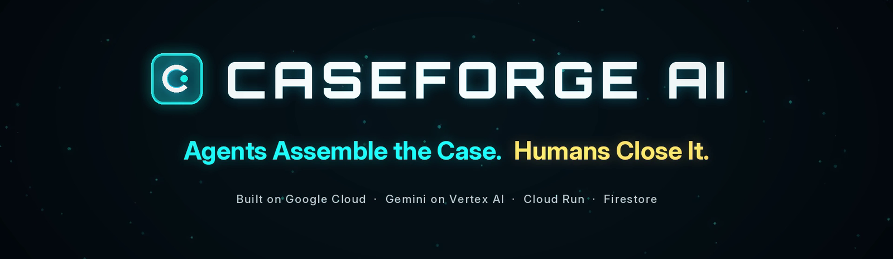
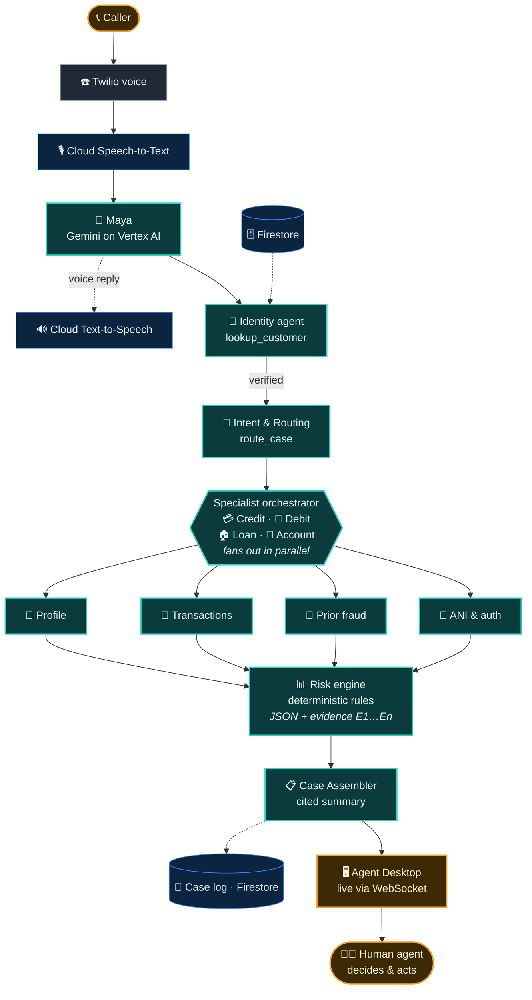
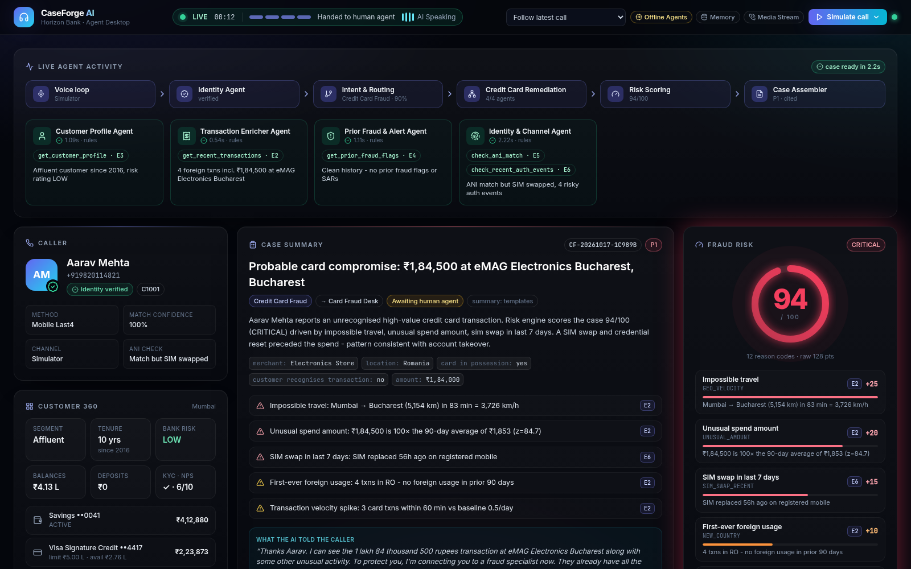
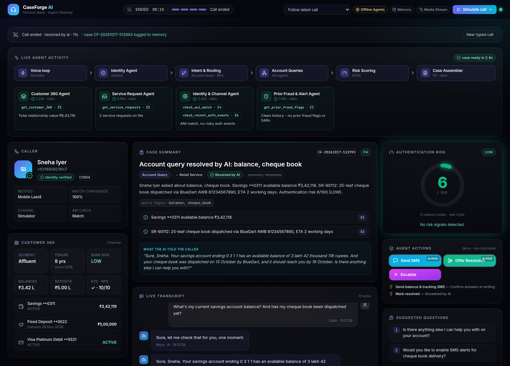

<div align="center">

<a href="https://caseforge-53w6bcjxtq-el.a.run.app/"></a>

# CaseForge AI
### Agents Assemble the Case. Humans Close It.

[](https://caseforge-53w6bcjxtq-el.a.run.app/)

    

</div>

> 🏦 **BFSI:** a multi-agent contact centre for banks, cards and lending, where every call can be a fraud case.

## 🔥 Problem → ✅ Solution
- 🔥 **Today:** human agents start from zero, juggling CRM, card and fraud tools. Industry estimates put **40–70% of handle time** on lookups, and fraud signals get missed.
- 🟦 **AI prepares:** while *Maya* talks, AI agents verify identity, understand the issue, investigate **in parallel** and score the risk.
- 🟧 **Human closes:** the agent gets a **cited case file**, a risk score and suggested actions before saying hello. Nothing fires without a human click.

## 🏗 Architecture



<details><summary><sub>Implementation notes</sub></summary><sub>Agent-to-agent communication is in-process through structured JSON handoffs inside one FastAPI service; A2A/ADK are not used. Each agent has a clear tool contract, so it can be exposed over A2A later.</sub></details>

## ☁ Google Cloud tools
| Service | Role |
|---|---|
| **Gemini on Vertex AI** | Function calling for the identity, intent and enrichment agents; JSON for the Case Assembler |
| **Cloud Speech-to-Text** | Streams the caller's phone audio (telephony model, en-IN) |
| **Cloud Text-to-Speech** | Maya's voice, streamed back to the caller |
| **Cloud Run** | One FastAPI container: Twilio webhooks, WebSockets and the React desktop |
| **Firestore** | Customer, card, loan and transaction data, plus the post-call case log |
| **Secret Manager** | Twilio credentials |
| **Cloud Build · Artifact Registry** | `gcloud run deploy --source .` builds and stores the image |

## 🎬 How to demo
Open the **[live Agent Desktop](https://caseforge-53w6bcjxtq-el.a.run.app/)**, then pick either way:

- 📞 **Real call:** dial **+1 507 708 6987** and talk to Maya. Your call appears live on the desktop.
- 🖱️ **Simulated call:** click **Simulate call ▾** and pick a scenario.

Watch the panels fill in: identity → intent → parallel agents → risk → cited case → human handoff.

<table><tr>
<td width="50%"><br><sub>Credit card fraud: 94 CRITICAL → Card Fraud Desk</sub></td>
<td width="50%"><br><sub>Account query: resolved by AI</sub></td>
</tr></table>

**Example: credit card fraud.** Aarav Mehta gives his mobile's last 4 digits → verified (evidence E1) → "₹1,84,000 charge in Romania" → 4 agents run in parallel and find a SIM swap → impossible travel, an unusual amount, the SIM swap and 8 more signals → **93–94 CRITICAL** → cited case → Card Fraud Desk, P1.

| 🏧 Debit card stolen | 🏠 Loan hardship | 🧾 Balance query |
|---|---|---|
| 94 CRITICAL | 92 CRITICAL | 6 LOW · resolved by AI |

## 🎯 Risk indicators
`GEO_VELOCITY` +25 · `UNUSUAL_AMOUNT` +20 · `ATM_VELOCITY` +20 · `SIM_SWAP_RECENT` +15 · `NEW_COUNTRY` +10 · `CARD_TESTING` +10 → `score = 100·(1−e^(−raw/45))`, computed in code, not by the LLM.<br>
**Bands:** 🟢 LOW < 30 ≤ 🟡 MEDIUM < 60 ≤ 🟠 HIGH < 80 ≤ 🔴 CRITICAL

## 📈 Scalability
- ⟷ **Horizontal:** each new product (wealth, insurance…) gets its own specialist orchestrator.
- ↕ **Vertical:** each new enrichment agent joins the parallel fan-out and deepens the case.

## 🛡 AI safety
📎 **Full Citations** · 🔐 **Least-Privilege** · 🗂️ **Complete Logging** · ✋ **No Autonomous Actions** · 🧑‍⚖️ **Human-in-the-Loop**

## 📞 Environment & call flow
| Variable | Purpose |
|---|---|
| `LLM_MODE` · `GEMINI_MODEL` · `GOOGLE_CLOUD_PROJECT` | `vertex` / `mock` · the Gemini model · the GCP project |
| `DATA_BACKEND` · `VOICE_MODE` | `firestore` / `memory` · `media_stream` / `gather` |
| `TWILIO_ACCOUNT_SID` · `TWILIO_AUTH_TOKEN` · `PUBLIC_BASE_URL` | Twilio credentials · the public URL for the webhooks |
| `DEMO_TRUSTED_CALLER_NUMBERS` · `HANDOFF_NUMBER` | Caller numbers treated as registered · an E.164 number for the human agent |

A caller dials the Twilio number → Twilio posts to `/twilio/voice` on Cloud Run → Maya handles the call. At handoff, if `HANDOFF_NUMBER` is set, Twilio `<Dial>`s that real human agent while the desktop shows the full case; if it's empty, the AI keeps the line.

## 💻 Local setup
```bash
# Option A: Docker
cp .env.example .env
docker compose up --build
# open http://localhost:8080 → "Simulate call" → pick a scenario

# Option B: no Docker (Python 3.11+ and Node 18+)
./scripts/run_local.sh            # builds the UI and serves everything on :8080
./scripts/run_local.sh --dev      # backend :8080 + hot-reload UI on :5173
```

---
<p align="center"><b>For any further details, reach out to</b><br>
Team Name: <b>Jurassic Prompt</b><br>
<a href="mailto:priyadarshi.prakirn@gmail.com">Prakirn Priyadarshi</a> · <a href="mailto:pandeyaryaman187@gmail.com">Aryaman Pandey</a></p>
