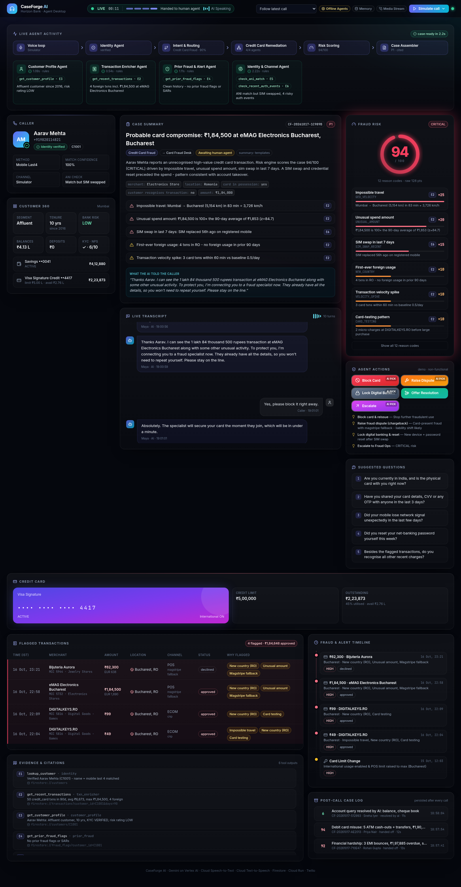

# CaseForge AI — every call arrives pre-investigated

**A multi-agent BFSI contact centre on Google Cloud.** A customer calls a real phone number. *Maya*, a Gemini voice
assistant, greets them, verifies who they are and works out what they need. A specialist orchestrator then
fans out parallel tool-calling agents across the bank's data. A deterministic engine scores the risk, and a Case
Assembler writes a cited case file. All of it streams live onto a dark, real-time **Agent Desktop** before the human
agent says hello.



| | |
|---|---|
| **Voice** | Twilio number → **Media Streams** (μ-law 8 kHz) → **Cloud Speech-to-Text** streaming → Gemini agents → **Cloud Text-to-Speech** → caller. Barge-in supported. Fallback: Twilio `<Gather>` + Cloud TTS `<Play>` (`VOICE_MODE=gather`). |
| **Reasoning** | **Vertex AI Gemini** (`gemini-3.5-flash`, configurable, with a fallback chain) using function calling for every agent. |
| **Agents** | Greeting & Identity, Intent & Routing, 4 orchestrators (Credit Card, Debit Card, Loan, Account Queries), 11 specialist sub-agents, a deterministic Risk Scoring Agent, and the Case Assembler. |
| **Data** | **Firestore**: 10 customers, 343 transactions, cards, accounts, loans with EMI schedules, fraud flags/SARs, auth events (SIM swap, password reset…). Seeded automatically on first run. |
| **Runtime** | **FastAPI on Cloud Run** (one container that also serves the UI), **Secret Manager** for Twilio credentials. |
| **UI** | React + Vite + Tailwind + Framer Motion, updated in real time over WebSockets. |
| **Offline mode** | `LLM_MODE=mock` + `DATA_BACKEND=memory` runs the whole flow with no GCP or Twilio, and has a call simulator built in. |

---

## Contents
1. [Architecture](#1-architecture)
2. [Quick start (offline, 2 minutes)](#2-quick-start-offline-2-minutes)
3. [Project structure](#3-project-structure)
4. [Google Cloud setup & API enablement](#4-google-cloud-setup--api-enablement)
5. [Seeding the data](#5-seeding-the-data)
6. [Twilio phone number setup](#6-twilio-phone-number-setup)
7. [Running locally (offline / real GCP / real phone)](#7-running-locally)
8. [Deploying to Cloud Run](#8-deploying-to-cloud-run)
9. [Environment variables](#9-environment-variables)
10. [Live demo script (what to say on the call)](#10-live-demo-script)
11. [The four demo flows in detail](#11-the-four-demo-flows-in-detail)
12. [Agents, tools & risk scoring reference](#12-agents-tools--risk-scoring-reference)
13. [Testing & verification](#13-testing--verification)
14. [Troubleshooting, limits & caveats](#14-troubleshooting-limits--caveats)

---

## 1. Architecture

```
 Caller ☎ ──PSTN──► Twilio number ──POST /twilio/voice──► Cloud Run (FastAPI)
                         │                                   │
                         └──wss /twilio/media-stream ◄───────┘  (μ-law 8 kHz both ways, barge-in via "clear")
                                   │
             Cloud Speech-to-Text (streaming, model "telephony", en-IN)
                                   │ final transcript
                                   ▼
                      ┌──────── CallSession (state machine) ────────┐
                      │ GREETING → IDENTITY → INTENT → ORCHESTRATING │
                      │            → HANDOFF | RESOLVED → ENDED      │
                      └──────────────────────────────────────────────┘
   Greeting & Identity Agent (Gemini + lookup_customer)
   Intent & Routing Agent  (Gemini, forced route_case function call)
                                   │ route
         ┌─────────────────────────┼──────────────────────────┬──────────────────────┐
  Credit Card Orchestrator   Debit Card Orchestrator     Loan Orchestrator     Account Queries Orch.
   ├ Customer Profile         ├ Customer Profile          ├ Customer Profile     ├ Customer 360
   ├ Transaction Enricher     ├ Transaction Enricher      ├ EMI Schedule         ├ Service Requests
   ├ Prior Fraud & Alerts     ├ ATM Velocity              ├ Repayment & Bounce   ├ Identity & Channel
   └ Identity & Channel       ├ Linked Account            ├ Hardship Signals     └ Prior Fraud
        (asyncio.gather)      ├ Prior Fraud               └ Identity & Channel     (+ AI resolution of
                              └ Identity & Channel                                 simple queries)
                                   │ evidence E1..En (every tool output)
                                   ▼
          Risk Scoring Agent (deterministic, reason codes) → Case Assembler (Gemini JSON + citations)
                                   │                                    │
         Cloud TTS ◄── caller_message (spoken handoff)        Firestore `cases` (post-call log)
                                   │
           EventHub ──/ws/desktop──► React Agent Desktop (live transcript, agents, risk, case…)
```

**Design choices**

* **Gemini decides, Python enforces.** Agents use real Gemini function calling, but every tool is bound to the
  *verified* customer. The model can never read another customer's data, even under prompt injection.
* **Explainable risk.** The 0–100 score is computed in code from weighted reason codes, so it is reproducible and
  auditable. Gemini writes the narrative, not the number.
* **Citations everywhere.** Every tool call becomes an evidence item (`E1`, `E2`…), each with its tool, agent and
  data source. Every key finding in the case cites one; hover a chip in the UI to see it.
* **Graceful degradation.** If Gemini is slow or unavailable, each agent falls back to its deterministic path, so
  a live demo never dies on stage. The UI shows `Gemini` vs `rules` per agent.
* **One event stream.** Phone calls, the simulator and typed calls all drive the same `CallSession`, which emits the
  same events, so the desktop behaves the same whichever channel you use.

---

## 2. Quick start (offline, 2 minutes)

No GCP or Twilio needed. This uses the deterministic agents and the in-memory data.

```bash
# Option A: Docker
cp .env.example .env
docker compose up --build
# open http://localhost:8080 → "Simulate call" → pick a scenario

# Option B: no Docker (Python 3.11+ and Node 18+)
./scripts/run_local.sh            # builds the UI and serves everything on :8080
./scripts/run_local.sh --dev      # backend :8080 + hot-reload UI on http://localhost:5173
```

On the desktop you can:
* click one of the four **scenario cards** (or *Simulate call ▾* in the top bar). A scripted caller talks to Maya
  through the real pipeline.
* click **Start a typed call** and type as the caller yourself (try the identities in the cheat-sheet table).

---

## 3. Project structure

```
caseforge-ai/
├── Dockerfile                    # multi-stage: build React UI → FastAPI image that serves it (Cloud Run)
├── docker-compose.yml            # local stack (+ optional Firestore emulator profile)
├── Makefile                      # make run / dev / test / verify / deploy
├── .env.example                  # every setting, documented (also copied to backend/.env.example)
├── scripts/
│   ├── setup_gcp.sh              # enable APIs, Firestore, service account + IAM, Secret Manager secrets
│   ├── deploy_cloud_run.sh       # gcloud run deploy --source . (+ sets PUBLIC_BASE_URL, wires Twilio)
│   ├── setup_twilio.py           # search/buy a number, point voice webhook + status callback at the backend
│   ├── seed_firestore.sh         # python -m app.seed [--force]
│   ├── local_tunnel.sh           # ngrok tunnel for phone testing against your laptop
│   └── run_local.sh              # run without Docker (prod-style or --dev)
├── backend/
│   ├── requirements.txt
│   ├── app/
│   │   ├── main.py               # FastAPI app: REST, /ws/desktop, simulator, static UI
│   │   ├── config.py             # env settings + sm:// Secret Manager resolution
│   │   ├── seed.py               # Firestore seeding CLI
│   │   ├── core/
│   │   │   ├── session.py        # CallSession state machine shared by all channels + post-call logging
│   │   │   ├── llm.py            # google-genai wrapper: Vertex/Gemini API, fallback models, tool loop, JSON mode
│   │   │   ├── datastore.py      # DataStore interface, Firestore + in-memory implementations, time shifting
│   │   │   ├── events.py         # real-time EventHub (replay on reconnect)
│   │   │   └── simulator.py      # 4 scripted demo calls (also the README demo script)
│   │   ├── agents/
│   │   │   ├── identity.py       # Greeting & Identity Agent (lookup_customer)
│   │   │   ├── intent.py         # Intent & Routing Agent (route_case function, entity extraction)
│   │   │   ├── orchestrators.py  # 4 orchestrators: parallel fan-out → risk → route panel → assembler
│   │   │   ├── subagents.py      # 11 specialist sub-agents (Gemini tool loops + deterministic summaries)
│   │   │   ├── tools.py          # 13 tools: JSON-schema declarations + implementations + evidence registry
│   │   │   ├── risk.py           # deterministic risk scoring: velocity, geo-velocity, unusual spend…
│   │   │   ├── assembler.py      # Case Assembler: structured cited JSON (Gemini + templates)
│   │   │   └── textnum.py        # spoken numbers ↔ digits/amounts ("one lakh eighty four thousand")
│   │   ├── voice/
│   │   │   ├── twilio_routes.py  # /twilio/voice, /gather, /hold, /after-stream, /status, Media Streams WS
│   │   │   ├── stt.py            # Cloud STT streaming recogniser (auto-restart before the 5-min limit)
│   │   │   └── tts.py            # Cloud TTS → μ-law (streams) / MP3 (<Play>), cached
│   │   └── data/seed_data.json   # all dummy data (generated by scripts/generate_seed_data.py)
│   ├── scripts/
│   │   ├── generate_seed_data.py # deterministic dummy-data generator
│   │   └── verify_ws.py          # live websocket smoke test of all 4 scenarios
│   └── tests/                    # pytest: 4 flows, Twilio Gather + Media Streams, Gemini tool loop
├── frontend/
│   ├── package.json, vite.config.js, tailwind.config.js, index.html
│   └── src/
│       ├── App.jsx               # desktop layout
│       ├── hooks/useDesktopSocket.js   # reconnecting websocket + rAF event batching
│       ├── lib/store.js          # event-sourced reducer (events → call state)
│       ├── lib/format.js
│       └── components/           # TopBar, IdleHero, AgentActivity, IdentityCard, Customer360, Transcript,
│                                 # RiskPanel, CaseSummary, ActionsPanel(+SuggestedQuestions),
│                                 # FlaggedTransactions, FraudTimeline, RoutePanels, CaseLog(+Evidence), ui
└── docs/caseforge-ui.png
```

---

## 4. Google Cloud setup & API enablement

Prerequisites: a GCP project with billing, the [`gcloud` CLI](https://cloud.google.com/sdk/docs/install), and
Python 3.11+.

```bash
gcloud auth login
gcloud auth application-default login          # lets your laptop use Vertex AI / STT / TTS / Firestore
export PROJECT_ID=your-project-id REGION=asia-south1
TWILIO_ACCOUNT_SID=ACxxx TWILIO_AUTH_TOKEN=xxx ./scripts/setup_gcp.sh
```

`setup_gcp.sh` is idempotent and does the following:

| Step | Detail |
|---|---|
| Enable APIs | `run`, `cloudbuild`, `artifactregistry`, `aiplatform` (Vertex AI Gemini), `speech`, `texttospeech`, `firestore`, `secretmanager`, `logging` |
| Firestore | Creates the `(default)` database in **Native mode** in `$REGION` |
| Service account | `caseforge-sa` with `roles/aiplatform.user`, `roles/datastore.user`, `roles/secretmanager.secretAccessor`, `roles/logging.logWriter`, `roles/speech.client` |
| Secret Manager | `twilio-account-sid`, `twilio-auth-token` (+ `gemini-api-key` if `GEMINI_API_KEY` is set) |

To do it by hand instead:
```bash
gcloud services enable run.googleapis.com cloudbuild.googleapis.com artifactregistry.googleapis.com \
  aiplatform.googleapis.com speech.googleapis.com texttospeech.googleapis.com firestore.googleapis.com \
  secretmanager.googleapis.com
gcloud firestore databases create --location=asia-south1 --type=firestore-native
printf '%s' "$TWILIO_AUTH_TOKEN" | gcloud secrets create twilio-auth-token --data-file=-
```

**Secrets in the app.** On Cloud Run, the deploy script mounts secrets as env vars (`--set-secrets`). Locally, any
env value may be a reference such as `TWILIO_AUTH_TOKEN=sm://twilio-auth-token`, which `config.py` resolves through
Secret Manager at start-up.

**Gemini model.** The default is `gemini-3.5-flash`, served from the `global` Vertex AI location, and
`gemini-3.1-flash-lite` is the automatic fallback. `gemini-1.5-pro` and `gemini-2.0-flash` (named in the original
brief) have been **retired** on Vertex AI, so they are not used. To change the model, set `GEMINI_MODEL`. To use an
AI Studio key instead of Vertex AI, set `LLM_MODE=gemini_api` and `GEMINI_API_KEY`.

---

## 5. Seeding the data

All dummy data is in `backend/app/data/seed_data.json`. It is fictitious, Firestore-ready and Indian-retail-bank
flavoured:

| Collection | Count | Highlights |
|---|---|---|
| `customers` | 10 | clean (C1004, C1006, C1007, C1009, C1010-vulnerable senior) and risky (C1005 prior SAR + chargeback abuse, C1008 mule account) |
| `cards` | 11 | credit and debit, with limits, outstanding and linked accounts |
| `accounts` | 12 | savings + fixed deposits |
| `loans` | 3 | home and personal loans with full EMI schedules, bounces, DPD and SMA bucket |
| `transactions` | 343 | 90 days per customer with MCC, city/country, lat/lon, channel, device and entry mode. **Fraud case:** ₹1,84,500 card-present spend in Bucharest 83 minutes after a Mumbai coffee, after card-testing micro-charges |
| `fraud_flags` | 6 | SARs, chargeback abuse, mule suspicion, NCRP complaint |
| `auth_events` | 64 | SIM swap, password reset, MPIN reset, new device, beneficiary added, OTP/PIN failures |
| `service_requests` | 3 | cheque book dispatched (AWB), EMI-date change… |

**Seeding**
* **Automatic:** with `DATA_BACKEND=firestore` and `AUTO_SEED=true` (the default), the first start seeds Firestore. A
  `_meta/seed` document guards against re-seeding.
* **Manual:** `GOOGLE_CLOUD_PROJECT=$PROJECT_ID ./scripts/seed_firestore.sh`. Add `--force` to overwrite, or
  `--dry-run` to only print the counts.
* **Emulator:** `docker compose --profile firestore up`, then set `FIRESTORE_EMULATOR_HOST=localhost:8085`.

**Time shifting.** Seed dates are anchored to a demo day. With `TIME_SHIFT_DATA=true`, every date is shifted so the
anchor becomes *today*. "SIM swap 2 days ago" and "last 90 days" stay true whenever you demo. If you demo days after
seeding Firestore, re-seed with `--force` so the dates line up again. To regenerate the data, run
`python backend/scripts/generate_seed_data.py`.

---

## 6. Twilio phone number setup

1. Create a Twilio account at <https://www.twilio.com>. Upgrade it (about $20 credit) for a clean demo: trial
   accounts play a trial notice and need a key press before your code runs.
2. Put `TWILIO_ACCOUNT_SID` and `TWILIO_AUTH_TOKEN` in `.env`. Use the plain values for the script; Cloud Run uses
   Secret Manager.
3. Buy a number and wire it up in one command:
   ```bash
   pip install twilio
   python3 scripts/setup_twilio.py --search --country US              # list a few numbers
   python3 scripts/setup_twilio.py --buy --country US --base-url https://<your-cloud-run-url>
   # or re-point a number you already own:
   python3 scripts/setup_twilio.py --number +14155550123 --base-url https://<url>
   ```
   This sets **Voice webhook** to `POST <url>/twilio/voice` and **Status callback** to `POST <url>/twilio/status`.
4. **Console alternative:** Phone Numbers → Manage → Active numbers → your number → *Voice Configuration* →
   "A call comes in" = **Webhook**, `https://<url>/twilio/voice`, **HTTP POST**. Status callback URL:
   `https://<url>/twilio/status`.

> **Indian numbers:** +91 Twilio numbers need a regulatory bundle that takes days to approve. For the hackathon, buy a
> US or UK number and call it from your phone (international rates apply), or use a VoIP/Twilio client. Add the
> number you'll call **from** to `DEMO_TRUSTED_CALLER_NUMBERS`, so the ANI check treats it as the customer's
> registered mobile. The fraud customer still shows *"match but SIM swapped"*.

**Voice modes** (`VOICE_MODE`)
* `media_stream` (default, the premium path): bidirectional Media Streams, Cloud STT streaming with interim results
  on screen, Cloud TTS μ-law audio, and barge-in (talking over Maya stops her).
* `gather` (robust fallback): Twilio does the speech recognition. Replies are Cloud TTS MP3s via `<Play>`
  (`TTS_MODE=cloud`) or Twilio `<Say>` (`TTS_MODE=twilio`). While agents work, a `/twilio/hold` redirect loop keeps
  the call alive, so webhooks never time out. Switch with one env var if anything misbehaves on the day.

**Handoff.** If you set `HANDOFF_NUMBER` (for example a teammate's phone), the call is `<Dial>`ed there once the case
is ready. If it is empty, Maya holds the line and reassures the caller while you take over on the desktop.

---

## 7. Running locally

| Goal | Settings |
|---|---|
| Offline demo (default) | `LLM_MODE=mock`, `DATA_BACKEND=memory` |
| Real Gemini, local data | `LLM_MODE=vertex`, `GOOGLE_CLOUD_PROJECT=…` (ADC from `gcloud auth application-default login`) |
| Full GCP | also `DATA_BACKEND=firestore` |
| Real phone → your laptop | `./scripts/local_tunnel.sh` (ngrok), set `PUBLIC_BASE_URL=https://<ngrok>` and restart, then `TWILIO_NUMBER=+1… ./scripts/local_tunnel.sh` re-points the number |

```bash
cp .env.example .env && $EDITOR .env
./scripts/run_local.sh               # http://localhost:8080
make test                            # offline test-suite
make verify                          # websocket smoke test of all 4 scenarios against :8080
```

---

## 8. Deploying to Cloud Run

```bash
export PROJECT_ID=your-project-id REGION=asia-south1
./scripts/deploy_cloud_run.sh                                 # builds with Cloud Build, deploys, sets PUBLIC_BASE_URL
TWILIO_NUMBER=+14155550123 ./scripts/deploy_cloud_run.sh      # …and re-points your Twilio number
```

What the script runs: `gcloud run deploy caseforge --source .` with:
* `--min-instances 1 --max-instances 1 --session-affinity --no-cpu-throttling`. Call state and websockets live in
  one warm instance, so there is no cold start when the phone rings and STT keeps streaming.
* `--timeout 3600`, which allows calls and websockets up to 60 minutes.
* `--service-account caseforge-sa`, plus `--set-secrets TWILIO_AUTH_TOKEN=twilio-auth-token:latest,…`.
* env: `LLM_MODE=vertex`, `DATA_BACKEND=firestore`, `VOICE_MODE=media_stream`, `VALIDATE_TWILIO_SIGNATURE=true`…
  Override any of them by exporting them before you run the script.

The script prints the **Agent desktop URL** (open it on the big screen) and the **voice webhook**.

---

## 9. Environment variables

All variables are documented in [`.env.example`](.env.example). The main ones:

| Variable | Default | Purpose |
|---|---|---|
| `PUBLIC_BASE_URL` | `http://localhost:8080` | Public HTTPS URL; Twilio webhooks + `wss://` stream URL are built from it |
| `LLM_MODE` | `mock` | `vertex` \| `gemini_api` \| `mock` |
| `GEMINI_MODEL` / `GEMINI_FALLBACK_MODELS` | `gemini-3.5-flash` / `gemini-3.1-flash-lite` | Model + fallback chain |
| `GOOGLE_CLOUD_PROJECT` / `GOOGLE_CLOUD_LOCATION` | – / `global` | Vertex AI project + location |
| `DATA_BACKEND` | `memory` | `firestore` \| `memory` (Firestore errors fall back to memory automatically) |
| `AUTO_SEED`, `TIME_SHIFT_DATA` | `true` | Seed on first run; keep dates relative to today |
| `VOICE_MODE` | `media_stream` | `media_stream` \| `gather` |
| `TTS_MODE`, `TTS_VOICE`, `TTS_LANGUAGE` | `cloud`, `en-IN-Neural2-A`, `en-IN` | Cloud TTS voice (any Neural2/WaveNet voice works) |
| `STT_LANGUAGE`, `STT_MODEL` | `en-IN`, `telephony` | Cloud STT (use `en-US` for US accents) |
| `TWILIO_ACCOUNT_SID`, `TWILIO_AUTH_TOKEN` | – | Plain values or `sm://secret-id` |
| `VALIDATE_TWILIO_SIGNATURE` | `false` (deploy: `true`) | Verify `X-Twilio-Signature` |
| `HANDOFF_NUMBER` | empty | E.164 number to `<Dial>` at handoff |
| `DEMO_TRUSTED_CALLER_NUMBERS` | empty | Your phone number(s), treated as the registered mobile for ANI checks |
| `BANK_NAME`, `AGENT_PERSONA` | `Horizon Bank`, `Maya` | Branding |
| `SIMULATOR_TURN_DELAY_S` | `1.6` | Pace of simulated calls |

---

## 10. Live demo script

Open the desktop URL on the projector. Call the Twilio number. Speak naturally; pauses are fine. Maya always starts
with: *"Hello, thank you for calling Horizon Bank. I'm Maya, your virtual assistant… could you please tell me your
full name?"*

Identities: **name + last 4 of the registered mobile** *or* **name + customer ID**. The cheat-sheet is on the
desktop's idle screen.

### Scenario A — Credit card fraud (account takeover) · ~90 s
| You say | What happens on screen |
|---|---|
| "Hi, my name is **Aarav Mehta**." | Transcript streams in; Identity Agent running |
| "The last four digits are **4 8 2 1**." | `lookup_customer` → **Identity verified**; Customer 360 fills in (Affluent, 10 yrs) |
| "I just got an SMS for a charge of about **one lakh eighty four thousand rupees** on my **credit card** at some electronics store in **Romania**. I've never been to Romania, I'm in Mumbai and the card is with me." | Intent → *Credit Card Fraud* (amount ₹1,84,000, location Romania). **Credit Card Orchestrator** fans out 4 agents in parallel. Risk gauge spins up to **94 CRITICAL**: impossible travel Mumbai→Bucharest at 3,700 km/h, 100× unusual amount, SIM swap 2 days ago, password reset from Bucharest, card testing, magstripe fallback. Flagged table highlights eMAG ₹1,84,500 and the declined jewellery attempt |
| *(Maya)* "I can see the 1 lakh 84 thousand 500 rupees transaction at eMAG Electronics Bucharest… connecting you to a fraud specialist…" | Case **P1 → Card Fraud Desk**, AI-recommended *Block Card / Raise Dispute / Lock Digital Banking* |
| "Yes, please block it right away." | Maya reassures: the specialist will secure the card as soon as they join |
| "Okay, thank you. Bye." | Call ends → **post-call case logged** |

**Talking point:** the caller *was* on the registered number, but the SIM was swapped 55 hours ago, so the Identity
& Channel Agent flags *"ANI match but SIM swapped"*. That is exactly the case a human could miss.

### Scenario B — Debit card stolen, ATM cash-out · ~80 s
| You say | On screen |
|---|---|
| "Hello, this is **Priya Nair**, my customer ID is **C1002**." | Verified by customer ID |
| "I **can't find my debit card** and I just woke up to SMS alerts for **several ATM withdrawals** last night, around **fifty thousand rupees**, and money was also transferred out of my savings account." | Debit Card Orchestrator: **6 parallel agents** incl. ATM Velocity + Linked Account. Risk **94 CRITICAL**: 5 ATM withdrawals at 5 ATMs within 1 h at 1–2 AM, 82% of balance drained, IMPS ₹95,000 to a payee added 11 minutes earlier after MPIN reset on a new device. Debit panel shows the ATM bars and the balance-drain meter |
| "Please freeze everything, I didn't do any of this." / "Thank you, that's all." | Actions: *Block Card, Freeze Account, Recall Funds (golden hour), Raise Dispute* |

### Scenario C — Home loan hardship (job loss) · ~75 s
| You say | On screen |
|---|---|
| "Hi, **Rohan Gupta** here." → "Last four of my mobile are **5562**." | Verified |
| "I **lost my job in July** and I've **missed my home loan EMIs** for the last two months. I want to know my options, can I get some relief or restructuring?" | Loan Orchestrator: EMI Schedule, Repayment & Bounce, Hardship Signals agents. **Delinquency risk 92**: 3 bounces, DPD 72 (SMA-1, near NPA), salary stopped 62 days, F&F settlement credit, savings ₹1.84 L → ₹6.2 k, card at 91% utilisation, viewed "EMI holiday" FAQ. The **Loan workspace** shows colour-coded EMI timelines and **pre-computed relief options** (tenure extension with the new EMI, 3-month holiday, charge waiver) |
| "Okay, I'll wait for the specialist. Thank you." | Recommended: *Offer Resolution, Waive Charges, Pause Collections* |

### Scenario D — Simple account query, resolved by AI · ~45 s
| You say | On screen |
|---|---|
| "Hi, I'm **Sneha Iyer**, mobile ending **9047**." | Verified |
| "What's my current **savings account balance**? And has my **cheque book** been dispatched yet?" | Account Queries Orchestrator. Risk **LOW**. Maya **answers directly** with the balance and the BlueDart dispatch date and ETA. Case marked **Resolved by AI**, with no handoff |
| "No, that's all. Thanks!" | Goodbye → logged as `RESOLVED_BY_AI` |

**Backup plan:** if the phone line or venue Wi-Fi fails, click **Simulate call ▾** on the desktop. The same four
scenarios play through the identical pipeline. You can also flip `VOICE_MODE=gather` and redeploy in about 1 minute.

---

## 11. The four demo flows in detail

Each flow is `simulator.py` scenario → `CallSession` → agents. The event sequence below is what the desktop receives.

### Flow 1 — Credit card fraud (`credit_card_fraud`, customer C1001)
1. `call.started` → Maya greets (`transcript`) → `identity.update(verified)` → `customer.snapshot`
2. `intent.classified` → `CREDIT_CARD_FRAUD`, entities `{amount:184000, location:"Romania", card_in_possession:true, customer_recognises_transaction:false}`
3. `orchestrator.started` (Credit Card Remediation) → 4 × `agent.started` *before* any completes (true parallel fan-out)
   * Customer Profile → `get_customer_profile`
   * Transaction Enricher → `get_recent_transactions(days=90, instrument=credit_card)`
   * Prior Fraud & Alert → `get_prior_fraud_flags` (clean history)
   * Identity & Channel → `check_ani_match`, `check_recent_auth_events`
4. `risk.scored`: **94 CRITICAL**: GEO_VELOCITY +25, UNUSUAL_AMOUNT +20, SIM_SWAP_RECENT +15, NEW_COUNTRY, VELOCITY_SPIKE, CARD_TESTING, CREDENTIAL_RESET (+10 each), HIGH_RISK_MCC, MAGSTRIPE_FALLBACK, NEW_DEVICE, LIMIT_CHANGE, ANI_SIM_SWAPPED (+5 each)
5. `case.assembled`: P1 → Card Fraud Desk, 4 flagged txns, timeline (SIM swap → password reset → new device → limit change → card testing → ₹1.84 L), suggested questions ("Did your mobile lose network signal unexpectedly in the last few days?"), caller message → spoken → `handoff`
6. Caller says goodbye → `call.ended` → `case.logged` (Firestore `cases/{case_id}` with transcript, duration, disposition)

### Flow 2 — Debit card (`debit_card_fraud`, C1002)
Debit Card Remediation Orchestrator with 6 parallel agents (adds **ATM Velocity** `get_atm_velocity(24h)` and **Linked
Account** `get_linked_account_activity(48h)`). Reason codes: ATM_VELOCITY, CASH_OUT_PATTERN, LINKED_ACCOUNT_DRAIN,
UNUSUAL_AMOUNT, VELOCITY_SPIKE, CREDENTIAL_RESET (MPIN), ODD_HOUR, LIMIT_EXHAUSTION, NEW_DEVICE, NEW_BENEFICIARY,
AUTH_FAILURES → **94 CRITICAL**. The route panel shows the ATM withdrawal bars and the linked-account drain.

### Flow 3 — Loan hardship (`loan_hardship`, C1003)
Loan Agent Orchestrator: Customer Profile, **EMI Schedule** (`get_emi_schedule`), **Repayment & Bounce**
(`get_repayment_history`), **Hardship Signals** (`get_hardship_signals`), Identity & Channel. The risk type is
**credit delinquency**: EMI_BOUNCES +30, DPD_60_PLUS +25, SALARY_STOPPED +20, BALANCE_DEPLETION +10,
HIGH_CARD_UTILISATION +10, FULL_AND_FINAL_SETTLEMENT +5, DIGITAL_DISTRESS_INTENT +5 → **92**. The route panel shows
EMI timelines and relief options computed with the EMI formula (for example, a 60-month tenure extension and the new
EMI).

### Flow 4 — Simple account query (`account_query`, C1004)
Account Queries Orchestrator: Customer 360, Service Requests, Identity & Channel, Prior Fraud. Query types
`balance` + `cheque_book` are in the *simple* set, so the panel's `resolution = RESOLVED_BY_AI`. The caller hears the
answer straight away, the case status is `RESOLVED_BY_AI`, and there is no handoff. A complex or unknown request
(for example "change my address and dispute a charge") is `HANDOFF_REQUIRED` and goes to a human.

---

## 12. Agents, tools & risk scoring reference

| Agent | Tools (Gemini function declarations) | Output |
|---|---|---|
| Greeting & Identity | `lookup_customer(name, mobile_last4 \| customer_id)` | verified customer, max 3 attempts |
| Intent & Routing | `route_case(intent, confidence, summary, entities{amount,date,merchant,location,card_last4,card_in_possession,loan_type,hardship_reason,query_types[]}, needs_clarification, clarifying_question)` (forced, mode ANY) | route + entities (asks a clarifying question if unclear) |
| Customer Profile | `get_customer_profile` | segment, tenure, KYC, products |
| Transaction Enricher | `get_recent_transactions(days, instrument)` | 90-day stats + recent txns with MCC/location/device |
| Prior Fraud & Alert | `get_prior_fraud_flags` | flags, SARs |
| Identity & Channel | `check_ani_match`, `check_recent_auth_events(days)` | ANI verdict, SIM swap/resets/devices |
| ATM Velocity | `get_atm_velocity(hours)` | count, distinct ATMs, max/hour, baseline |
| Linked Account | `get_linked_account_activity(hours)` | outflows, % drained, new-payee transfers |
| EMI Schedule | `get_emi_schedule(loan_id?)` | last 12 + next 3 instalments |
| Repayment & Bounce | `get_repayment_history` | on-time/late/bounced, DPD, overdue |
| Hardship Signals | `get_hardship_signals` | salary stop, depletion, utilisation, distress intent |
| Customer 360 | `get_customer_360` | all balances, deposits, cards, loans, SRs |
| Service Requests | `get_service_requests` | cheque book, address change… |
| Risk Scoring | *(deterministic)* | score 0–100, band, reason codes with evidence + txn ids |
| Case Assembler | Gemini JSON mode (`response_json_schema`) | headline, narrative, cited key findings, questions, actions, caller message |

**Risk formula:** `score = 100 · (1 − e^(−raw/45))`, where `raw` is a baseline from the bank's risk rating plus the
reason-code points. This is a saturating curve, so many weak signals don't trivially reach 100. Bands: LOW < 30 ≤
MEDIUM < 60 ≤ HIGH < 80 ≤ CRITICAL. Detectors include:
* geo-velocity (haversine distance / time > 800 km/h)
* new country
* unusual amount (> 5× the 90-day mean, with z-score)
* 1-hour velocity
* card testing
* high-risk MCC
* magstripe fallback
* ATM velocity
* cash-out ratio
* new-beneficiary drain
* odd hour
* SIM swap, credential reset, new device, limit change
* ANI mismatch or swapped
* prior SAR, open high-severity flags, serial disputer
* the loan delinquency set

**Case JSON** (stored in Firestore `cases`): `case_id, status, queue, priority, route, intent, customer, risk{score,
band, reasons[], flagged_transactions[]}, summary{headline, narrative, key_findings[{text, citations[], severity}]},
suggested_questions[], recommended_actions[], caller_message, agent_findings[], route_panel, timeline[], citations[{id,
tool, agent, args, source, summary}], post_call{duration_s, disposition, …}, transcript[]`.

---

## 13. Testing & verification

```bash
cd backend && python -m pytest -q tests        # 8 tests, fully offline
```
* `test_flows.py`: all 4 scenarios end-to-end. It checks routes, risk bands, reason codes, that every citation
  exists, and that the fan-out is parallel (all sub-agents start before the first finishes).
* `test_twilio.py`: a full **Gather-mode** call (TwiML, hold loop, AI answer, hangup), plus a **Media Streams**
  websocket call with fake STT/TTS (start → greeting audio + marks → 3 turns → hold → case → stop → case logged).
* `test_gemini_path.py`: the Gemini function declarations are valid `google-genai` objects, and the tool loop runs
  a real `lookup_customer` call against a fake model, keeping thought signatures intact.

To smoke-test the websocket against a running server:
```bash
python backend/scripts/verify_ws.py --base http://localhost:8080      # or your Cloud Run URL
# [PASS] credit_card_fraud  events=85 agents=6 tools=6 risk=94 CRITICAL status=PENDING_AGENT
# [PASS] debit_card_fraud   events=88 agents=8 tools=8 risk=94 CRITICAL status=PENDING_AGENT
# [PASS] loan_hardship      events=83 agents=7 tools=7 risk=92 CRITICAL status=PENDING_AGENT
# [PASS] account_query      events=70 agents=6 tools=6 risk=6 LOW status=RESOLVED_BY_AI
```

**Before going on stage:** deploy, open the desktop, run `verify_ws.py` against the Cloud Run URL, then place one
real test call per scenario.

---

## 14. Troubleshooting, limits & caveats

| Symptom | Fix |
|---|---|
| Call connects, then silence (media_stream) | `PUBLIC_BASE_URL` must be the exact public `https://` URL (deploy script sets it). Check Cloud Run logs for STT/TTS permission errors. Switch to `VOICE_MODE=gather` as a fallback |
| "Application error" from Twilio | Webhook must be **HTTP POST** to `/twilio/voice`. If `VALIDATE_TWILIO_SIGNATURE=true`, `PUBLIC_BASE_URL` must match the URL configured in Twilio exactly |
| Gemini 404 / model not found | Model IDs change. Set `GEMINI_MODEL` to a current Flash model and keep `GOOGLE_CLOUD_LOCATION=global`. The fallback chain and deterministic paths keep the demo running meanwhile |
| Names misheard | Speak the identifiers clearly, or use the customer ID (e.g. "C one zero zero two"). Phrase hints for all demo names are sent to STT. With Indian accents, `STT_LANGUAGE=en-IN` works best |
| Desktop shows nothing during a phone call | Single instance required (`--max-instances 1`, set by the deploy script). The desktop must point at the same service |
| Dates look stale in Firestore | `./scripts/seed_firestore.sh --force` (time-shifts to today) |

**Limits and honest caveats**
* State (live sessions, event replay) is in-process, so run exactly one Cloud Run instance. That suits a demo; for
  production, move the EventHub to Pub/Sub or Redis and the sessions to Firestore or Memorystore.
* Action buttons (Block Card, Raise Dispute…) are **intentionally non-functional**. They show a "demo mode" toast.
* Latency per turn is about STT endpointing + one or two Gemini calls + TTS, typically 1.5–3 s. The parallel case
  build takes roughly 4–10 s with Gemini; Maya covers it with a natural hold line.
* All customer data is fictitious. ANI matching uses the dummy registered mobiles, plus your
  `DEMO_TRUSTED_CALLER_NUMBERS`.
